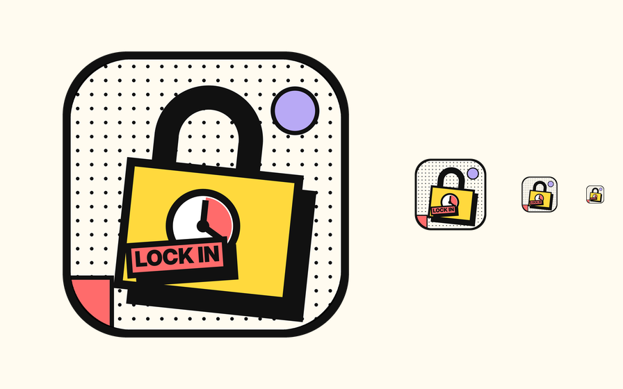

# LockIn

A Pomodoro focus timer for macOS, built for students. It borrows the flow of
[Session](https://stayinsession.com/) (set an intention, focus, reflect, break, repeat; countdown in
the menu bar) and adds what a student actually needs: focus time tracked **per class and per side
project**, with daily, weekly and monthly stats, weekly goals per subject, Google Tasks next to the
timer, and optional logging of every block to your calendar.

The UI is loud neo-brutalism: cream dot-grid paper, hard black borders, offset solid shadows, and
coral / yellow / lavender slabs.



## Features

- **Focus / short break / long break cycle** with configurable lengths, auto-start toggles, and
  presets (25/5, 45/10, 50/10, 90/20). ±5 minute nudges mid-block. A focus block never ends on its
  own: when the countdown hits zero it chimes and turns into a stopwatch until you finish it.
- **Intention before, reflection after.** Type one line about what you are locking in on; when the
  block ends you rate your focus (1–5), jot what got done, and can still pick the subject or fix the
  start and end times. The intention clears for the next block.
- **Subjects.** Classes, projects and "other", each with any emoji you like, a color, a category
  and an optional weekly goal. Pick one before starting; the time is attributed to it.
- **Categories.** Tag subjects with "Math", "Computer Science", or anything you type, and the stats
  roll them up: Calculus plus Linear Algebra show as one Math total.
- **Log and edit blocks by hand.** Forgot to start the timer, or forgot to pause it? The Log tab
  lists every block by day; add one, or click any block (there, under Recent blocks in Stats, or in
  the Today card on the timer) to change its start, end, focused minutes, subject, intention, rating
  or notes, or delete it. Focused time is typed freely ("40", "1:30", "1.5h"). Editing the start or
  end changes only that field and the focused time follows; editing the focused time moves the end.
- **Stats.** Today / this week / this month totals, current and best streak, a stacked chart by
  hour (day) or by day (week, month) colored by subject, breakdowns by category and by subject with
  share of total, and the recent blocks with their intentions and ratings. Step back and forward by
  day, week or month, jump to any date, and click a bar in the week or month chart to open that day.
- **Day timeline.** The bottom of the Focus screen shows the day's blocks on a horizontal,
  side-scrolling 24-hour timeline with a week strip of daily totals. Click a block to edit it; the running block is drawn live.
- **Menu bar countdown** with a compact control panel (start/pause, skip, reset, +5, subject picker).
- **Google Tasks.** See your open tasks, add and complete them, and push one into the intention
  field with "Focus on it". Uses your own OAuth client; tokens live in the Keychain.
- **Calendar logging.** Every finished block becomes an event in the Apple Calendar you choose.
  Notion Calendar reads Apple/iCloud and Google calendars, so this is how your focus time shows up
  there. (Notion Calendar has no public write API, so this is the bridge.)
- **Banner.** The scrolling strip at the top mixes motivational quotes, jokes and your live stats,
  reshuffled daily. Turn it off in Settings if you want quiet.
- Notifications and a chime at phase changes. Keyboard: `⌘↩` start/pause, `⌘K` skip, `⌘R` reset,
  `⌘=` / `⌘-` add or remove five minutes, `Space` toggles the timer when no text field has focus.

## Building

Requirements: macOS 14 Sonoma or later, Xcode 16 or later.

1. Open `LockIn.xcodeproj`.
2. Select the `LockIn` scheme and your Mac as the destination.
3. In the target's *Signing & Capabilities*, pick your team (the project uses automatic signing).
4. Run (`⌘R`).

The project uses Xcode's synchronized folders, so every file under `LockIn/` is part of the target
automatically. Data is stored with SwiftData in the app's container; nothing leaves your Mac except
calls you explicitly enable (Google Tasks).

## Google Tasks setup (one-time, ~3 minutes)

LockIn talks to Google directly from your Mac, so it needs an OAuth client of your own.

1. In the [Google Cloud Console](https://console.cloud.google.com/apis/credentials) create a project
   and enable the **Google Tasks API**.
2. *APIs & Services → OAuth consent screen*: choose **External**, fill in the app name, and add your
   own Google account as a **test user**.
3. *Credentials → Create credentials → OAuth client ID*, application type **Desktop app**. Copy the
   client ID and client secret.
4. In LockIn: *Settings → Google Tasks*, paste both, then *Tasks → Connect*. Your browser opens; after
   you approve, LockIn catches the redirect on `127.0.0.1` and you are done.

## Project layout

```
LockIn/
  LockInApp.swift          App entry, window, menu bar extra, commands
  Theme/Theme.swift        Palette, type, dot grid, brutal cards and buttons
  Models/Models.swift      SwiftData models: Subject, FocusSession (+ seed data)
  Models/Stats.swift       Pure aggregation for the stats screen
  Engine/TimerEngine.swift Wall-clock countdown, phase cycle, session logging
  Engine/AppSettings.swift UserDefaults-backed settings
  Views/                   Timer, Subjects, Stats, Log, Tasks, Settings, Reflection, SessionEditor, MenuBar
  Integrations/            Google Tasks (OAuth + API), Calendar (EventKit), Keychain
scripts/make_icon.py       Regenerates the app icon set
```

## Regenerating the icon

```
python3 scripts/make_icon.py
```

Needs Pillow. Writes all macOS sizes into `LockIn/Assets.xcassets/AppIcon.appiconset` and a preview
to `docs/icon-preview.png`.
